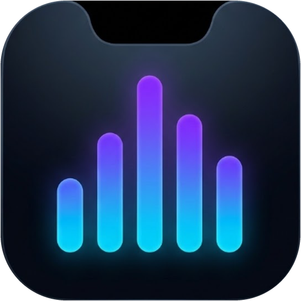

<div align="center">



# Windows Dynamic Island

[-0078D4?style=for-the-badge&logo=windows&logoColor=white)](https://github.com/lepi-da-vinci/dynamic-island)
[](https://dotnet.microsoft.com/)
[](https://github.com/lepi-da-vinci/dynamic-island)
[](https://github.com/lepi-da-vinci/dynamic-island)
[](LICENSE)

<br/>

**Aplikasi Dynamic Island native, ultra-ringan, dan responsif untuk Windows 10 dan 11.**  
Menggabungkan keindahan estetika *NotchNook* satu kesatuan dengan integrasi mendalam Windows Core Audio, GSMTC Media Controls, lirik tersinkronisasi, dan fitur produktivitas harian.

<br/>

<!-- QUICK INSTALL BUTTONS -->
[](#instalasi--cara-menjalankan)
&nbsp;&nbsp;
[](https://github.com/lepi-da-vinci/dynamic-island/releases/latest)

</div>

---

## Fitur Utama

### 1. Siluet One-Piece NotchNook yang Menyatu
* **Satu Desain Utuh Menempel di Atas Layar**: Menempel *flush* di bibir paling atas layar monitor (`Y = 0`) dengan lekukan telinga cekung (*concave ears*) yang mulus dan radius bawah elegan. Menghilangkan ilusi oval terpisah atau latar penahan yang kaku.
* **18 Custom Bespoke Vector SVG Icons (Zero Emoji)**: Seluruh antarmuka dirancang bebas emoji bawaan sistem operasi. Menggunakan vektor geometris tajam (`GeomMusic`, `GeomFolderTray`, `GeomFocusTimer`, `GeomSliders`, `GeomPlay`, `GeomPause`, `GeomSkipPrev`, `GeomSkipNext`, `GeomSpeakerOn`, `GeomSpeakerMuted`, `GeomHeadphones`, `GeomBrightnessSun`, `GeomMicOn`, `GeomMicMuted`, `GeomBolt`, `GeomShield`, `GeomChevronUp`, `GeomClosePower`, `GeomWifi`, `GeomWifiOff`) sehingga tampilan selalu konsisten tanpa risiko rendering kotak font emoji.

### 2. Real-Time 5-Band WASAPI Audio Visualizer dan Synced Lyrics
* **True Song-Synchronized Spectrum**: Menggunakan tangkapan native COM **WASAPI Loopback PCM Capture** (`IAudioCaptureClient`) yang dipecah secara *real-time* menjadi 5 pita frekuensi musikal (*Sub-Bass/Kick*, *Low-Mid*, *Vocals/Lead*, *Snare/Presence*, *Hi-Hat*) dilengkapi *Automatic Gain Control* (AGC). Gelombang bergerak hidup mengikuti ketukan lagu di Spotify, Chrome, Edge, YouTube, atau VLC.
* **Lirik Lagu Real-Time (LRCLIB Engine)**: Mengambil lirik lagu tersinkronisasi waktu (*time-synced .lrc*) dengan cache offline lokal. Menampilkan panggung lirik 3-baris mengambang di mode *Expanded*, serta pergeseran horizontal (*smooth one-way tempo pan*) di mode *Compact*.

### 3. Mode Simpan (Tucked Top Edge) dan Dynamic Click-Through
* **Anti-Blocking Tab Browser**: Saat Anda perlu mengakses tab Chrome/Edge atau tombol aplikasi di bibir atas layar, klik tombol **"Simpan"** atau klik kanan pada pulau. Dynamic Island otomatis terlipat menjadi garis aksen tipis 5px.
* **Win32 WS_EX_TRANSPARENT dan WM_NCHITTEST Cerdas**: Setiap piksel di luar fisik Dynamic Island (termasuk efek bayangan *drop-shadow*) berstatus tembus klik (*click-through* 100%) sehingga kursor dapat mengeklik tab browser tepat di belakangnya tanpa halangan.

### 4. Control Center dan Capsule Sliders Modern
* **Modern Line-Only Sliders**: Slider Volume dan Kecerahan Layar berbentuk kapsul minimalis modern tanpa titik *knob* bundar yang memotong garis.
* **Multi-Role Microphone Mute dan OSD**: Mendeteksi status *mute* mikrofon dari berbagai perangkat (laptop internal microphone Realtek maupun earphone Bluetooth/TWS EDIFIER) secara instan dalam 100ms *fast-polling*.
* **Grafik Baterai Presisi**: Representasi bentuk baterai elegan dengan lambang petir presisi di tengah, dinamis berubah warna saat mengisi daya (*charging*), normal, atau lemah (*low battery*).
* **Notifikasi Jaringan Wi-Fi**: Mendeteksi sambungan dan pemutusan jaringan Wi-Fi secara instan lengkap dengan nama SSID.

### 5. Rak File Sementara (File Drop Shelf / Tray)
* Tarik (*drag*) gambar atau file dari File Explorer / Browser ke Dynamic Island untuk menyimpannya sementara di rak *tray*.
* Tarik keluar file kapan saja ke WhatsApp Web, Discord, Telegram, Gmail, atau folder lain tanpa harus membuka dua jendela Explorer berdampingan.

### 6. Timer Fokus Pomodoro Produktif
* Mode jam yang dapat beralih ke timer fokus 25 menit dan waktu istirahat 5 menit dengan kontrol tombol *Play/Pause* instan.

### 7. Integrasi Notifikasi Windows Real-Time
* Mendeteksi notifikasi pesan masuk dari WhatsApp, Telegram, Instagram, dan aplikasi sistem secara langsung melalui pembacaan Windows Notification Store (`wpndatabase.db`).

---

## Instalasi & Cara Menjalankan

### Prasyarat Sistem
* **Sistem Operasi**: Windows 10 (versi 2004 / build 19041+) atau Windows 11 (64-bit).
* **Runtime**: [.NET 10 SDK](https://dotnet.microsoft.com/download) atau [.NET 9 / 10 Desktop Runtime](https://dotnet.microsoft.com/download).

---

### Metode 1: One-Click Installer via PowerShell (Bebas Peringatan SmartScreen)

Buka **PowerShell** (tekan `Win + X` lalu pilih Terminal / PowerShell) dan jalankan perintah satu baris berikut:

```powershell
irm https://raw.githubusercontent.com/lepi-da-vinci/dynamic-island/main/install.ps1 | iex
```

> **Catatan:** Script `install.ps1` akan memasang aplikasi secara standar ke `%LOCALAPPDATA%\Programs\WindowsDynamicIsland`, mendaftarkannya secara resmi di **Windows Settings -> Apps -> Installed Apps**, menambahkan ke Start Menu & Desktop, mengaktifkan Startup otomatis, serta membuka blokir keamanan Windows (`Unblock-File`).

---

### Metode 2: GUI Setup Installer (`WindowsDynamicIsland-Setup.exe`)

1. Unduh file **`WindowsDynamicIsland-Setup.exe`** dari halaman [GitHub Releases](https://github.com/lepi-da-vinci/dynamic-island/releases/latest).
2. Jalankan `WindowsDynamicIsland-Setup.exe` untuk membuka jendela **Setup Wizard** modern.
3. Pilih opsi Shortcut Desktop, Start Menu, dan Autostart, lalu klik **Install Sekarang**.

---

### Metode 3: Clone & Build dari Source Code

Jika Anda ingin mengompilasi dari source code sendiri:

1. **Clone repository ini:**
   ```powershell
   git clone https://github.com/lepi-da-vinci/dynamic-island.git
   cd dynamic-island
   ```

2. **Jalankan script installer lokal:**
   ```powershell
   .\install.ps1
   ```

   *atau buka jendela Setup Wizard GUI langsung:*
   ```powershell
   dotnet run --project src/WindowsDynamicIsland/WindowsDynamicIsland.csproj -c Release -- --setup
   ```

---

### Cara Uninstall Aplikasi (Standar Windows)

Karena aplikasi terdaftar secara resmi di sistem Windows, Anda dapat menghapusnya seperti aplikasi Windows normal lainnya melalui salah satu cara berikut:

1. **Melalui Pengaturan Windows (Settings)**:
   * Buka **Windows Settings** (`Win + I`) -> **Apps** -> **Installed apps** (atau *Apps & features*).
   * Cari **Windows Dynamic Island**, klik ikon titik tiga di sebelahnya, lalu pilih **Uninstall**.
2. **Melalui Start Menu Windows**:
   * Buka **Start Menu** -> semua aplikasi -> folder **Windows Dynamic Island** -> klik **Uninstall Windows Dynamic Island**.
3. **Melalui PowerShell One-Liner**:
   ```powershell
   irm https://raw.githubusercontent.com/lepi-da-vinci/dynamic-island/main/uninstall.ps1 | iex
   ```

---

### Catatan Keamanan Windows SmartScreen & Smart App Control

Untuk instalasi paling mulus tanpa peringatan **Windows Defender SmartScreen**, selalu gunakan **Metode 1 (PowerShell One-Liner)** di atas (disarankan dijalankan sebagai **Administrator**). Script `install.ps1` secara otomatis mengunduh paket *unpacked* (dengan runtime resmi bertanda tangan digital Microsoft Corporation), menambahkan pengecualian folder ke Windows Defender, serta menandatangani binary aplikasi secara lokal dengan sertifikat *Authenticode Code Signing*.

* **Jika muncul layar biru Windows SmartScreen ("Windows protected your PC")** saat menjalankan file `.exe` yang diunduh manual dari browser:
  1. Klik teks bergaris bawah **More info** (atau *Informasi selengkapnya*).
  2. Klik tombol **Run anyway** (atau *Tetap jalankan*).
* **Jika pada laptop OEM Windows 11 baru muncul pesan "An Application Control policy has blocked this file"**:
  Hal ini disebabkan oleh fitur **Smart App Control (SAC)** bawaan pabrik Windows 11 yang memblokir semua aplikasi open-source tanpa sertifikat komersial EV berbayar. Anda dapat menjalankan PowerShell sebagai **Administrator** saat menginstal, atau menonaktifkan Smart App Control melalui **Windows Security -> App & browser control -> Smart App Control settings -> Off**.

---

## Pintasan & Gestur Interaktif

| Aksi Mouse / Keyboard | Fungsi |
| :--- | :--- |
| **Arahkan Kursor (Hover)** | Membuka *Expanded Dashboard* dengan animasi pegas elastis (*Spring Physics*). |
| **Klik Kanan di Pulau** | Berganti cepat antar 4 Tab (*Musik & Lirik* -> *Rak File* -> *Pomodoro Fokus* -> *Pusat Kontrol Sistem*), atau melipat ke atas (*Mode Simpan*) saat mode compact. |
| **Klik Tengah (Middle Click)** | Langsung **Play / Pause** lagu yang sedang diputar. |
| **Scroll Wheel di Atas Pulau** | Menyesuaikan **Volume Audio Sistem** Windows secara instan dengan OSD kapsul halus. |
| **Shift + Scroll Wheel** | Menyesuaikan **Kecerahan Layar Monitor** (*Screen Brightness*). |
| **Drag & Drop File ke Pulau** | Otomatis membuka tab **Rak File** untuk menyimpan file sementara. |
| **Tahan Left Alt + Klik** | Menembus pulau (*Click-Through Bypass*) jika Anda ingin mengeklik aplikasi di belakangnya tanpa memindahkan pulau. |
| **Klik Tombol "Simpan"** | Melipat pulau ke bibir atas layar (5px) agar tab browser di belakangnya 100% bebas diklik. |

---

## Arsitektur & Struktur Proyek

```text
WindowsDynamicIsland/
├── src/
│   └── WindowsDynamicIsland/
│       ├── Core/
│       │   ├── Win32Interop.cs              # Win32 P/Invoke, WS_EX_TRANSPARENT, WM_NCHITTEST, Fullscreen Detect
│       │   ├── IslandStateMachine.cs        # State Engine: IdlePill, CompactMedia, Toast, Expanded, Tucked
│       │   └── SpringPhysics.cs             # Second-order harmonic oscillator (60-120 FPS render loop)
│       ├── Services/
│       │   ├── MediaSessionService.cs       # Windows GSMTC Media Controller & Adaptive Glow Extractor
│       │   ├── AudioService.cs              # Native WASAPI Loopback 5-Band Equalizer & Multi-Role Mic Mute
│       │   ├── BrightnessService.cs         # WMI & DDC/CI monitor brightness adjustment
│       │   ├── LyricsService.cs             # LRCLIB API client, LRC parser & Local disk caching
│       │   ├── HardwareTelemetryService.cs  # Battery, Wi-Fi, Privacy dot (Webcam/Mic in-use detector)
│       │   ├── NotificationListenerService.cs # Windows wpndatabase.db SQLite live notification query
│       │   ├── FileShelfService.cs          # Temporary Drag-and-Drop Dropzone Tray & thumbnail loader
│       │   └── PomodoroTimerService.cs      # Productivity countdown timer (Focus 25m / Break 5m)
│       ├── UI/
│       │   ├── MainWindow.xaml              # Unified NotchNook XAML layout & bespoke vector geometries
│       │   └── MainWindow.xaml.cs           # Compositor render loop, slider dragging, mouse gestures
│       ├── App.xaml                         # 20 Bespoke Vector Path geometries & segmented pill styles
│       ├── App.xaml.cs                      # Single-instance mutex & application lifecycle
│       ├── app.manifest                     # PerMonitorV2 High-DPI scaling configuration
│       └── WindowsDynamicIsland.csproj      # .NET 10 Target dengan Windows 10.0.19041.0 SDK
├── install.ps1                              # One-click automated installer & launcher script
├── WindowsDynamicIsland.slnx                # Modern Visual Studio Solution file
└── README.md                                # Dokumentasi proyek & panduan penggunaan
```

---

## Performa & Konsumsi Sumber Daya

* **Memori (RAM)**: Hanya menggunakan **~20 - 30 MB** RAM saat aktif.
* **Prosesor (CPU)**: **0.0% CPU** saat *idle* berkat sistem *frame-rate throttling* otomatis. Loop render 60-120 FPS hanya berjalan saat terjadi animasi *morphing*, *hover*, atau saat pemutar musik memproses gelombang audio *real-time*.
* **Zero External Dependencies**: Menggunakan native COM interop Windows murni tanpa paket NuGet pihak ketiga yang membebani sistem.

---

## Lisensi

Proyek ini dirilis di bawah lisensi [MIT License](LICENSE). Anda bebas menggunakannya, memodifikasinya, dan mengembangkannya kembali.
